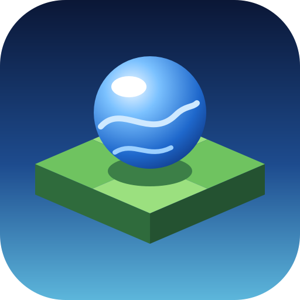
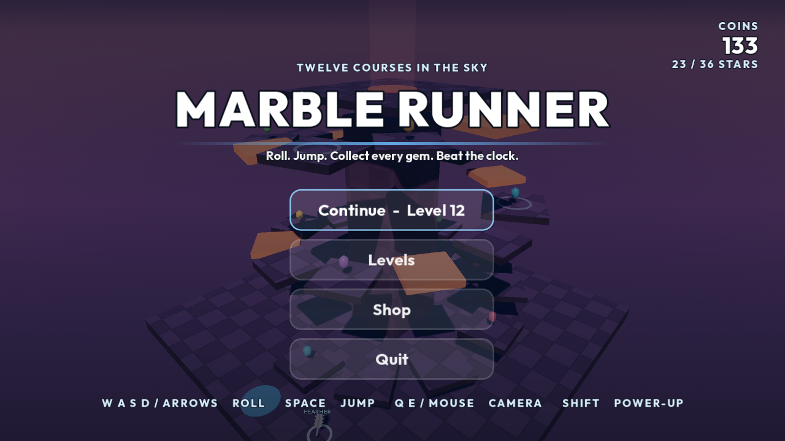
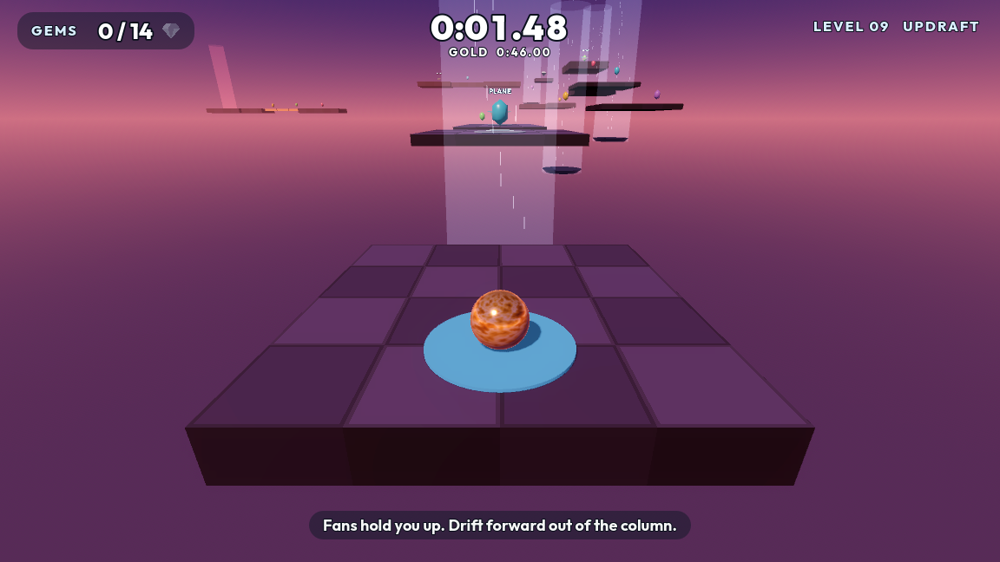
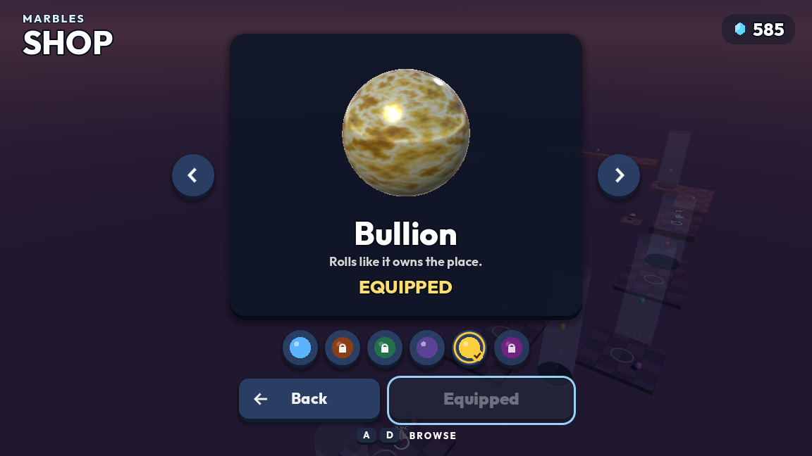
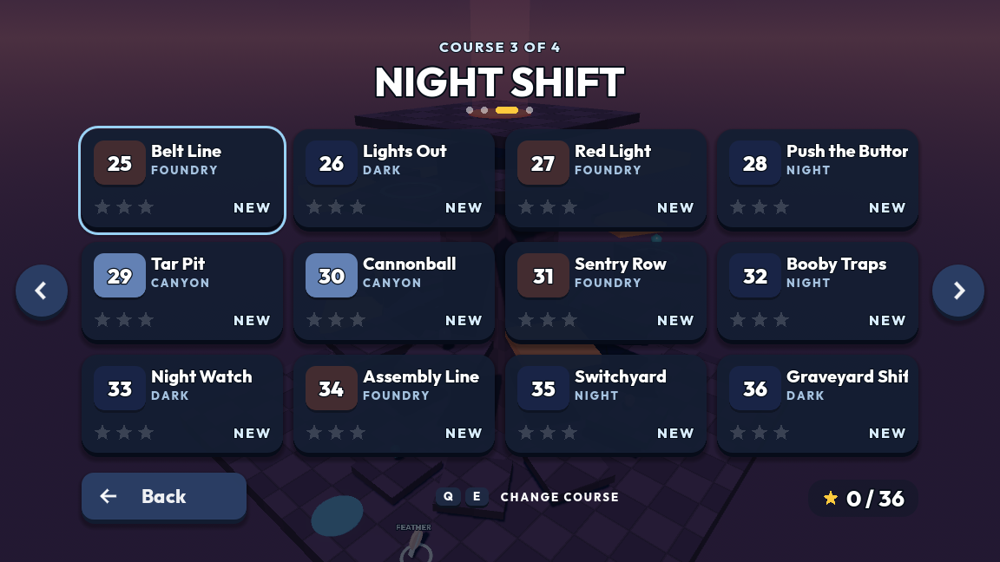

<div align="center">



# Marble Runner

[](LICENSE) [](https://godotengine.org/) [](https://docs.godotengine.org/en/stable/tutorials/scripting/gdscript/index.html)

**A marble platformer across sixty levels in the sky and beyond.**

Roll, jump, swim and glide a physics marble through floating levels. Collect
every gem to open the finish, then do it again faster for the stars.

[**Try it live**](https://kaushalmeena.github.io/marble-runner/)

</div>

---

## Screenshots

<table>
  <tr>
    <td width="50%"></td>
    <td width="50%"></td>
  </tr>
</table>

<details>
<summary>More screenshots</summary>

<table>
  <tr>
    <td width="50%"></td>
    <td width="50%"></td>
  </tr>
</table>

</details>

## Features

- **A marble you roll, not steer** — it is a physics body driven by torque, so
  it has real momentum: it carries speed off ramps and slides on ice.
- **Sixty levels, easy to hard** — five courses of twelve: Sky Courses, Far
  Side, Night Shift, Storm Peak and Grand Tour. A course opens with short
  levels that each teach one idea and closes with long ones that turn
  corners, climb and combine everything. Grand Tour is long from the start.
- **Gems open the finish** — every level is a collection problem as well as a
  route, and the open ones let you choose the order.
- **Things in the way** — moving platforms, bumpers, sweeping bars, boost and
  bounce pads, fans, ice, crumbling tiles, conveyor belts, tar, blinking laser
  beams, cannons, and floor buttons that build bridges of hard light.
- **Rival marbles** — red ones roll a fixed line, purple ones hunt you on
  their own patch, orange ones stay put and shoot. Drop on one from above, or
  shield up, and it pops.
- **Portals, keys and gates** — rings that pass your speed through, and gates
  that open for one key each.
- **Worlds with weather** — pools you sink and swim in, low gravity on the
  moon, heavy gravity in the foundry, a wind that never stops, and night
  levels lit only by the marble. The HUD names what is in force.
- **Nine power-ups** — super jump, boost, plane, magnet, stopwatch, shield,
  double jump, grip and flare. They switch on as you touch them, run side by
  side, and picking up another of the same adds its time.
- **Traps** — pickups in a dark bubble that slow you, reverse your steering
  or weigh you down for a few seconds. A shield soaks them up.
- **Stars and best times** — three stars per level against gold and silver
  targets. Checkpoints mean a fall costs time, not the attempt.
- **Coins and skins** — gems and new stars pay coins, spent on marbles in the
  shop.
- **Ten palettes** — meadow, desert, tundra, dusk, reef, moon, night, storm,
  foundry and canyon.
- **Cheat codes** — typed during play, no menu. See below.

## Tech Stack

| Area           | Tools                                                                                                         |
| -------------- | --------------------------------------------------------------------------------------------------------------- |
| **Engine**     | [Godot 4.7](https://godotengine.org/), Jolt physics, Compatibility renderer for the web build                  |
| **Language**   | [GDScript 2](https://docs.godotengine.org/en/stable/tutorials/scripting/gdscript/index.html), statically typed  |
| **Art**        | Primitive meshes built in code, one position-projected tile shader                                         |
| **Typography** | [Outfit](https://fonts.google.com/specimen/Outfit)                                                             |
| **Audio**      | Generated with Python's [`wave`](https://docs.python.org/3/library/wave.html) module                           |
| **Hosting**    | [GitHub Pages](https://pages.github.com/)                                                                      |

## Getting Started

These instructions will get you a copy of the project up and running on your
local machine for development purposes.

### Requirements

To install and run this project you need:

- [Godot 4.7](https://godotengine.org/download/) or newer
- [git](https://git-scm.com/downloads) (only to clone this repository)

### Installation

To set up everything on your local machine, follow these steps:

1. Clone this repo and then change directory to the `marble-runner` folder:

```bash
git clone https://github.com/kaushalmeena/marble-runner.git
cd marble-runner
```

2. Import the project, either by opening `project.godot` in the editor or from
   the command line:

```bash
godot --headless --import
```

### Running

To play the game:

```bash
godot
```

### Building

To export the web build:

```bash
godot --headless --export-release "Web" dist/web/index.html
```

Output lands in `dist/web`. The `Web` preset is committed, so this works on a
fresh clone once the matching export templates are installed.

## Usage

| Action          | Keyboard                    | Gamepad      |
| --------------- | --------------------------- | ------------ |
| Roll            | `W` `A` `S` `D` or arrows   | Left stick   |
| Jump            | `Space` (hold to keep hopping) | `A`       |
| Turn the camera | `Q` `E`, or click and move the mouse | Right stick |
| Restart level   | `R`                         | `Back`       |
| Pause           | `Esc` or `P`                | `Start`      |

The camera also follows the marble on its own, so the movement keys and
`Space` are enough to play. On a touchscreen a stick and a jump button appear.

### Cheats

Type a word during a level. There is no prompt; the HUD confirms it. A run that
used a cheat still finishes, but records no time, stars or coins and does not
unlock the next level. The last two do not touch the run, so they are exempt.

| Code | Effect |
| --- | --- |
| `MOONBOOTS` | Low gravity |
| `BUBBLE` | Shield for a minute |
| `SKYHOOK` | Unlimited air jumps |
| `ZOOMZOOM` | Faster marble |
| `TICKTOCK` | Clock stopped for a minute |
| `ALLGEMS` | Every gem collected |
| `SKELETONKEY` | Three keys |
| `BOWLING` | Rival marbles knocked out |
| `TOOLKIT` | Every power-up at once |
| `GOLDMINE` | 500 coins |
| `ALLACCESS` | Every level unlocked |

## Deployment

Pushing to `main` exports the game and publishes it to GitHub Pages, via the
[deploy workflow](.github/workflows/deploy.yml). Pages needs its source set to
GitHub Actions for that to land.

## Credits

- [Outfit](https://fonts.google.com/specimen/Outfit) by **Smartsheet Inc.**,
  licensed under the [SIL Open Font License 1.1](assets/fonts/OFL.txt).

## Documentation

Full documentation is available in the [`/docs`](./docs) directory.

- [Architecture](./docs/architecture.md) — how the marble is rolled rather than
  steered, and which parts know about each other.
- [Levels](./docs/levels.md) — adding a level, what the builder can place, and
  the jump numbers levels are measured against.

## Contributing

Contributions are welcome! If you find a bug or have a feature request, please
[open an issue](https://github.com/kaushalmeena/marble-runner/issues/new/choose)
first to discuss it. For code changes, fork the repository, create a branch,
and open a pull request.

## License

This project is licensed under the MIT License — see the [LICENSE](LICENSE)
file for details.
